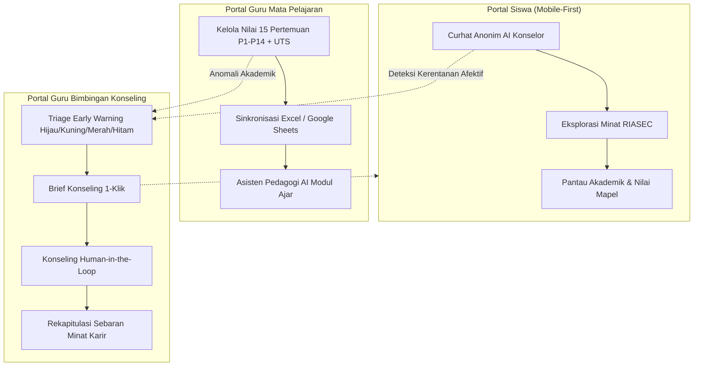

# 🔄 Alur & Alur Kerja Sistem (Project Flow) — LUNA (*Lentera untuk Nilai dan Asa*)

LUNA (*Lentera untuk Nilai dan Asa*) adalah platform ekosistem bimbingan konseling cerdas dan sistem deteksi dini (*Early Warning System*) berbasis AI untuk sekolah menengah. Platform ini menjembatani kolaborasi antara **Siswa**, **Guru Mata Pelajaran**, dan **Guru Bimbingan Konseling (BK)** secara etis, empatik, dan terukur.

---

## 1. Tiga Persona Pengguna & Perannya

---

## 2. Alur Kerja Detil Berdasarkan Peran

### 🌟 A. Alur Siswa (Portal Siswa — Mobile-First)
1. **Otentikasi & Profil Siswa**:
   * Siswa masuk menggunakan email sekolah (misal: `alisha@siswa.sch.id`) atau NISN.
   * Siswa dapat melihat ringkasan status akademik, rekap ketuntasan KKM, dan status bimbingan.
2. **Ruang Curhat LUNA (AI Counselor Companion)**:
   * Siswa dapat mencurahkan kendala belajar, stres akademis, atau dinamika pertemanan dengan aman.
   * Semua data teks diproteksi dengan penyamaran identitas pribadi (*PII Masking*) sebelum diproses oleh model kecerdasan buatan.
   * **Crisis Interceptor Guardrail**: Jika siswa mengetikkan frasa darurat (keinginan menyakiti diri/mengakhiri hidup), sistem langsung menghentikan respons biasa dan memunculkan banner intervensi krisis darurat dengan nomor **Hotline 119 ext 8**.
3. **Eksplorasi Minat Karir (RIASEC)**:
   * Siswa mengisi 30 butir asesmen aktivitas minat (5 butir per dimensi, skala 0–4).
   * Menghasilkan skor 0–20 untuk Realistic, Investigative, Artistic, Social, Enterprising, Conventional.
   * Hasil digunakan sebagai bahan refleksi mandiri dan materi dialog bersama Guru BK.

---

### 📚 B. Alur Guru Mata Pelajaran (Portal Guru Mapel)
1. **Login Sesuai Mata Pelajaran**:
   * Guru login dengan akun guru (misal: `guru@sekolah.sch.id` untuk Matematika atau `biologi@sekolah.sch.id` untuk Biologi).
   * Sistem otomatis membatasi akses input data hanya pada mata pelajaran yang diampu.
2. **Pengisian & Sinkronisasi Nilai Siswa**:
   * Guru dapat memperbarui nilai per pertemuan (`p1–p7`, `uts`, `p8–p14`) secara langsung di tabel.
   * **Sinkronisasi Cepat**: Guru dapat mengunggah berkas Excel (`.xlsx`, `.xls`), CSV (`.csv`), atau menautkan link Google Sheets kelas.
   * LUNA memvalidasi NISN, menghitung rata-rata kelas, dan menandai siswa yang memerlukan remidi (< 75).
3. **Asisten AI Pedagogi**:
   * Guru dapat berdiskusi dengan AI untuk merancang diferensiasi pembelajaran bagi siswa yang mengalami penurunan nilai.

---

### 🛡️ C. Alur Guru BK (Portal Konselor — Early Warning Hub)
1. **Dashboard Triage & Deteksi Dini**:
   * Sistem memantau 4 tingkat kerentanan (*flag levels*):
     * 🟢 **Hijau (Normal)**: Perkembangan akademik dan afektif baik.
     * 🟡 **Kuning (Warning)**: Terjadi penurunan nilai drastis atau kejenuhan belajar ringan.
     * 🔴 **Merah (Critical)**: Nilai di bawah KKM pada lebih dari 3 mapel atau ketidakhadiran tinggi.
     * ⚫ **Hitam (Crisis/Black Flag)**: Intersepsi frasa krisis keselamatan afektif.
2. **One-Click Counseling Brief**:
   * Konselor BK dapat mengklik satu tombol untuk menghasilkan ringkasan latar belakang siswa, bukti riwayat nilai, kutipan refleksi afektif, dan rekomendasi langkah dialog terarah.
3. **Rekapitulasi Minat & Karir Kelas**:
   * Menampilkan sebaran dimensi RIASEC kelas, podium minat teratas, dan rekomendasi studi lanjut siswa.

---

## 3. Alur Data & Etika Kecerdasan Buatan (Responsible AI)

1. **Prinsip Human-in-the-Loop**: AI LUNA tidak pernah mengambil keputusan sepihak atau memberikan sanksi. AI berfungsi sebagai penganalisis pola awal, sedangkan keputusan konseling tetap 100% berada di tangan guru dan konselor profesional.
2. **Zero Medical Labeling**: LUNA secara ketat menolak melabeli siswa dengan istilah medis/psikiatri (seperti "depresi mayor", "skizofrenia", atau "gangguan kecemasan"). LUNA menggunakan terminologi operasional bimbingan sekolah, seperti *"Siswa menunjukkan beban belajar tinggi dan memerlukan pendampingan afektif"*.
3. **Kepatuhan Privasi (UU PDP No. 27/2022)**: Data sensitif disamarkan menggunakan kode anonim sintetis (`SISWA-XX`) sehingga privasi siswa terlindungi secara menyeluruh.
